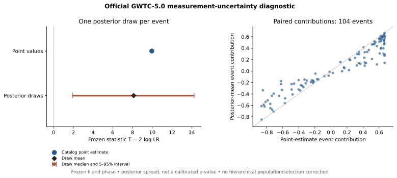

# Official posterior measurement uncertainty: issue #11

**PASS_CLOSED for the measurement-diagnostic task.** The result is positive but
attenuated after propagating event posterior uncertainty. This is not a
hierarchical population/selection test or a calibrated posterior p-value.

Baseline: merged PR #17 (`49b9f7849c6533605acf835f151cdcddd4ce52c9`) and the
PR #19 branch at `09b3aabd77dc40d98df06dee529dfb420f3591fa`. New implementation
and evidence are in PR #23. The successful raw-data execution ran commit
`bde312c022033c64cb3c25a3637add2a63d2e9f9` in
[workflow 38938072587](https://github.com/rickyjreyes/GWTC/actions/runs/38938072587).
All 16 ingest jobs and the complete-coverage diagnostic passed.

## Official source and transformation

The GWOSC GWTC-5.0 event-specific preferred PE records select **103
C00:IMRPhenomXPHM-SpinTaylor products and one C01:Mixed product**. Their source
chirp masses and M_sun units exactly match the frozen point-estimate table.
The source products are official [GWTC-5.0 stable release 9](https://gwosc.org/GWTC-5.0/),
Zenodo records 20348005 and 20348006. The Zenodo record version index 2 is a
different versioning layer from stable release 9; neither is silently renamed.

All **104/104** positive-mass holdout events were retrieved. The full manifest
has 161 holdout rows; the remaining 57 have no finite positive canonical
point-mass counterpart and were excluded by the already frozen rule, not by
posterior outcomes. Full raw size and official MD5 verification precede SHA-256,
dataset/field inspection and extraction. Total checked raw bytes:
**55,134,074,468**. Each lossless derivative retains every official
`chirp_mass_source` sample, with an array hash and equality check against its
raw source. These projections are labeled derivatives, not official HDF5 files.

The first retrieval attempt had TLS resets, timeouts and interrupted transfers.
Its failed receipts remain archived. It produced 59 valid per-event receipts,
including five saved before a shard timeout. The retry reused only projections
whose exact source identity and checksum still matched, resumed missing raw
transfers, and required full 104-event coverage before scoring. No event was
dropped to turn the gate green.

The accepted data contain **1,742,285 posterior samples**, 10,825–40,000 per
event. No explicit weight field was found in the chosen posterior tables;
equal posterior-draw weights are normalized within each event. Kish weight ESS
therefore equals the sample count up to floating-point roundoff. This is not
an autocorrelation-adjusted MCMC ESS; no chain-independence estimate is claimed.
Each realization draws one sample per event, never pooling all samples as
independent gravitational-wave events.

## Frozen diagnostic and results

k=9.7, the existing cosine/sine coefficients, phase, normalizer and source-mass
log transform are unchanged. The diagnostic uses 10,000 draws, seed 20261014.

| Statistic | Value |
|---|---:|
| Catalog point-value 2 log LR | 9.9501855796 |
| Exact empirical posterior expectation of additive statistic | 8.0892161628 |
| Monte Carlo posterior-draw mean | 8.1088344680 |
| Draw quantiles: 5%, 50%, 95% | 1.9336731089, 8.1279665195, 14.2449966225 |
| Fraction of positive posterior draws | 0.9853 |
| Full expected event coverage | 104 / 104 |
| Calibrated p-value | null |



The exact empirical-posterior expectation falls about **18.7%** below the
point score. The positive result is preserved with a meaningful attenuation
and broad posterior spread. The 98.53% fraction is a posterior-draw sign
diagnostic, not a frequentist significance. The mean of the additive log
statistic is not the logarithm of an integrated likelihood. PE priors,
population hyperparameters and injection-calibrated detection selection are
the separate #8 obligation. Earlier holdout exposure remains explicit; this
execution supplies no new unseen replication.

The CI output was downloaded with the Actions artifact size and SHA-256
verified. A local rerun on all 104 saved projections reproduced the point
score, Monte Carlo mean, quantiles and positive fraction **exactly**. A separate
direct empirical-moment calculation checks the event ledger and quantifies
Monte Carlo error without resampling or inventing a null p-value.

## Artifacts and reproduction

`results/official_2026-10-15/posterior_execution/` contains the original
`diagnostic.json`, `point_vs_posterior.csv`, `posterior_manifest.csv`, compressed
full raw-source receipts, local replay outputs, `review.json` and
`moment_check.json`. Diagnostic SHA-256:
`b7a97d89f2bd88877a532245cc2756516f4add673e254e4fcc96c52b7013f18a`.
`posterior_workflow_artifacts.json` records downloadable artifact IDs/digests
and expirations; they are temporary caches. Official source URLs, expected
sizes/MD5, computed SHA-256 and the retrieval path are durable Git evidence.
Large raw PE files and the temporary projections are not committed.

For cached replay, download all `pe-shard-*` artifacts from run 38938072587
into a fresh `NEW/pe_products` directory, then:

```bash
python scripts/run_official_pe_shard.py --collect --output NEW/pe_products
python scripts/gwtc_posterior_uncertainty.py --posterior-manifest NEW/pe_products/posterior_manifest.csv --require-complete --draws 10000 --seed 20261014 --event-table-output NEW/point_vs_posterior.csv --output NEW/diagnostic.json
python scripts/check_official_posterior_moments.py --receipts NEW/pe_products --diagnostic NEW/diagnostic.json --output NEW/moment_check.json
python scripts/plot_official_posterior_comparison.py --diagnostic NEW/diagnostic.json --output NEW/comparison.svg
python -m pytest -q
```

Without cached artifacts, run the same shard script with `--shard I --shards 16`
for I=0..15 into a fresh common product directory, or dispatch the official-PE
workflow. Expired/missing seed artifacts fall back to raw retrieval; checksum
verification remains mandatory. Preserve the frozen mapping from
`pe_input_mapping.json`. Metadata source bytes and their receipts are in
`metadata_snapshots.tar.gz` and `metadata_snapshot_receipt.json`.

The original ingestion/matching, deterministic sampling, unit/field, paired
result and interpretation criteria are satisfied. The full repository suite
passes 178 tests, and the official scientific execution passed separately.
Baseline-v2 reconciliation is documented in `BASELINE_V2_GATE_RECONCILIATION.md`;
historical PARTIAL/Class III and N0–N3 outcomes are unchanged.
